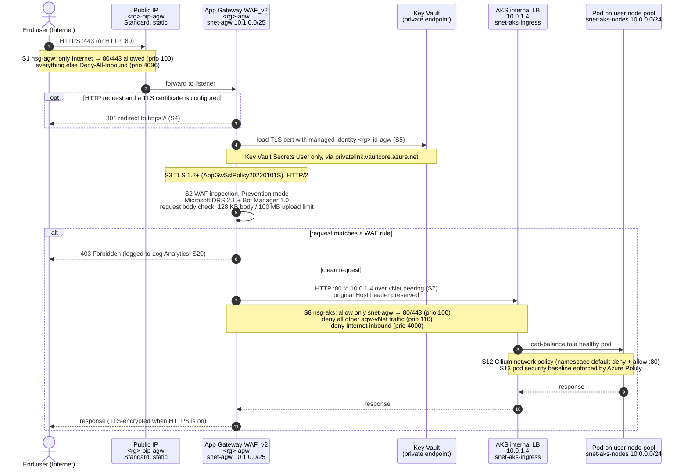
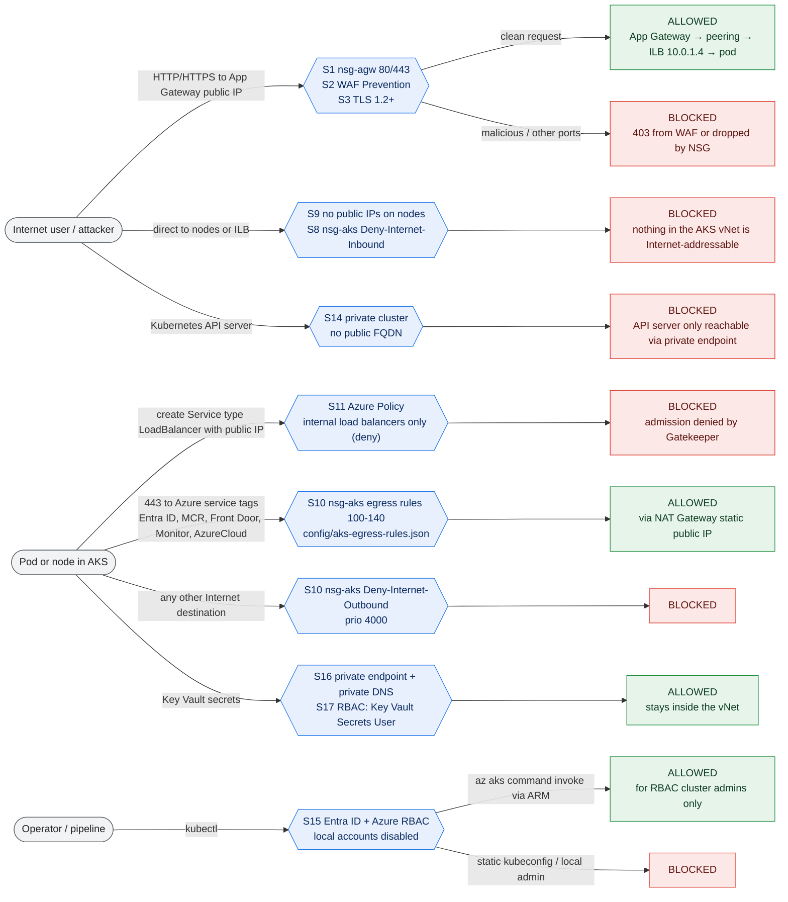
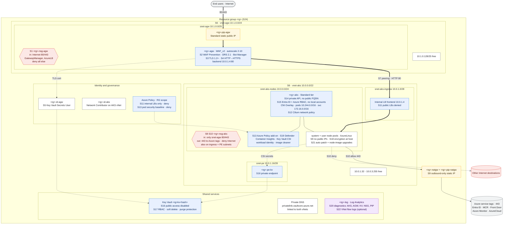
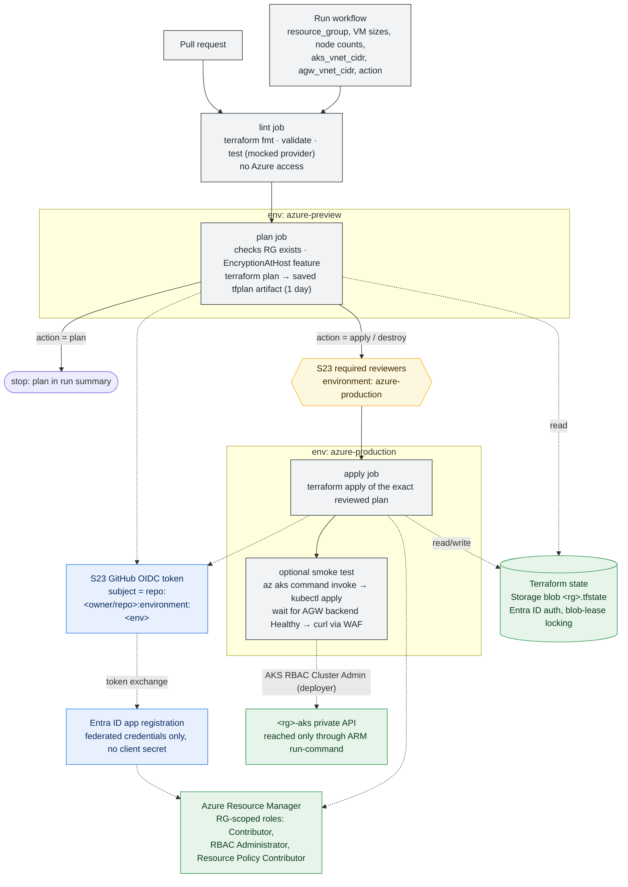

# Architecture & security diagrams

These diagrams describe what [`terraform/`](../terraform) deploys. Addresses shown are the **defaults**; every subnet is derived from the `aks_vnet_cidr` / `agw_vnet_cidr` inputs, so substitute your own ranges (see [README → Network design](../README.md#network-design-and-sizing)). `<rg>` is the resource group name, used as the naming prefix.

PNG exports of every diagram are in [`docs/images/`](images/) for use outside GitHub.

Security controls are tagged **S1–S24** in the diagrams and explained in the [security specification catalogue](#security-specification-catalogue) at the end.

* [1. End-user request flow](#1-end-user-request-flow)
* [2. Allowed vs. blocked traffic paths](#2-allowed-vs-blocked-traffic-paths)
* [3. Detailed network diagram](#3-detailed-network-diagram)
* [4. Deployment & operations flow](#4-deployment--operations-flow)
* [NSG rule reference](#nsg-rule-reference)
* [Security specification catalogue](#security-specification-catalogue)

---

## 1. End-user request flow

How a single user request reaches a pod. Every hop has at least one control that can reject the request.

> Health probes: App Gateway probes `GET /` on `10.0.1.4:80` every 30 s and expects 200–399. If none of the backends is healthy, users get 502 from the gateway. Traffic never bypasses the WAF to reach the cluster.

---

## 2. Allowed vs. blocked traffic paths

Every way traffic could try to enter or leave the environment, and the control that decides it.

---

## 3. Detailed network diagram

### Address plan (defaults)

In the network diagram, subnet and vNet titles omit the `<rg>-` prefix for space; full names are below.

| Network | CIDR | Derived from | Contents | NSG |
|---|---|---|---|---|
| `<rg>-vnet-agw` | `10.1.0.0/24` | `agw_vnet_cidr` | | |
| `<rg>-snet-agw` | `10.1.0.0/25` | 1st `/25` | App Gateway instances (max 10 autoscale) | `<rg>-nsg-agw` |
| `<rg>-vnet-aks` | `10.0.0.0/22` | `aks_vnet_cidr` | | |
| `<rg>-snet-aks-nodes` | `10.0.0.0/24` | 1st `/24` | Node NICs (251 nodes), NAT Gateway attached | `<rg>-nsg-aks` |
| `<rg>-snet-aks-ingress` | `10.0.1.0/28` | 1st `/28` of 2nd `/24` | Internal LB frontend `10.0.1.4` | `<rg>-nsg-aks` |
| `<rg>-snet-pe` | `10.0.1.16/28` | next `/28` | Key Vault private endpoint | `<rg>-nsg-aks` |
| Pod overlay | `10.244.0.0/16` | `pod_cidr` | Pod IPs (not routable outside the cluster) | n/a (Cilium policy) |
| Services | `172.16.0.0/16` | `service_cidr` | ClusterIPs; DNS `172.16.0.10` | n/a |

The plan fails if any of the four input ranges overlap.

---

## 4. Deployment & operations flow

How changes reach Azure. No long-lived credentials exist anywhere in the pipeline.

---

## NSG rule reference

### `<rg>-nsg-agw` (App Gateway subnet)

| Prio | Name | Direction | Source | Destination | Ports | Action |
|---|---|---|---|---|---|---|
| 100 | Allow-Internet-HTTP-HTTPS-Inbound | In | Internet | App Gateway subnet | TCP 80, 443 | Allow |
| 110 | Allow-GatewayManager-Inbound | In | GatewayManager | * | TCP 65200-65535 | Allow (required by AGW v2) |
| 120 | Allow-AzureLoadBalancer-Inbound | In | AzureLoadBalancer | * | * | Allow (health probes) |
| 4096 | Deny-All-Inbound | In | * | * | * | **Deny** |

Outbound uses the Azure defaults, which App Gateway v2 requires.

### `<rg>-nsg-aks` (node, ingress and private endpoint subnets)

| Prio | Name | Direction | Source | Destination | Ports | Action |
|---|---|---|---|---|---|---|
| 100 | Allow-AppGateway-HTTP-HTTPS-Inbound | In | App Gateway subnet | AKS vNet | TCP 80, 443 | Allow |
| 110 | Deny-AppGateway-Other-Inbound | In | App Gateway vNet | * | * | **Deny** |
| 4000 | Deny-Internet-Inbound | In | Internet | * | * | **Deny** |
| 100 | Allow-AzureActiveDirectory-443 | Out | * | AzureActiveDirectory | TCP 443 | Allow |
| 110 | Allow-MicrosoftContainerRegistry-443 | Out | * | MicrosoftContainerRegistry | TCP 443 | Allow |
| 120 | Allow-AzureFrontDoorFirstParty-443 | Out | * | AzureFrontDoor.FirstParty | TCP 443 | Allow |
| 130 | Allow-AzureMonitor-443 | Out | * | AzureMonitor | TCP 443 | Allow |
| 140 | Allow-AzureCloud-443 | Out | * | AzureCloud | TCP 443 | Allow |
| 4000 | Deny-Internet-Outbound | Out | * | Internet | * | **Deny** |

The outbound rules come from [`terraform/config/aks-egress-rules.json`](../terraform/config/aks-egress-rules.json). Azure's built-in rules (AllowVnetInBound/OutBound, AllowAzureLoadBalancerInBound, priority 65000+) still apply. They keep intra-vNet, peered and private endpoint traffic working.

---

## Security specification catalogue

| ID | Control | Where | Configuration | CIS Azure 1.4 section |
|---|---|---|---|---|
| S1 | App Gateway subnet NSG | `<rg>-nsg-agw` | Internet → 80/443 only; platform rules; deny-all at 4096 | 6 Networking |
| S2 | Web Application Firewall | `<rg>-wafpol` | Prevention mode; Microsoft DRS 2.1 + Bot Manager 1.0; request body inspection; 128 KB body, 100 MB upload | Defense in depth |
| S3 | TLS policy | `<rg>-agw` | `AppGwSslPolicy20220101S` (TLS 1.2+ only), HTTP/2 | 3 / 9 (TLS ≥ 1.2) |
| S4 | HTTP → HTTPS redirect | `<rg>-agw` | Permanent redirect when `app_gateway_certificate_kv_uri` is set | Encryption in transit |
| S5 | Certificate access by managed identity | `<rg>-id-agw` | Key Vault Secrets User on the vault only; no secrets in config | 8 Key Vault |
| S6 | Separate vNets | `<rg>-vnet-agw`, `<rg>-vnet-aks` | Internet-facing tier isolated from the cluster network | 6 Networking |
| S7 | Restricted peering | both peerings | No forwarded traffic, no gateway transit, no remote gateways | 6 Networking |
| S8 | AKS inbound NSG | `<rg>-nsg-aks` | Only App Gateway subnet on 80/443; rest of AGW vNet denied; Internet denied | 6.1 / 6.2 (no RDP/SSH from Internet) |
| S9 | No public IPs on nodes, controlled egress | node subnet | `node_public_ip_enabled = false`; `default_outbound_access_enabled = false`; NAT Gateway (`outboundType userAssignedNATGateway`), so no public LB is created | 6 Networking |
| S10 | Egress allow-list | `<rg>-nsg-aks` + JSON | 443 to five Azure service tags; deny Internet at 4000; editable | 6 Networking |
| S11 | Internal load balancers only | Azure Policy | Built-in `3fc4dc25…` with effect **deny** | Defense in depth |
| S12 | Pod network policy | AKS | Cilium dataplane + network policy; sample app uses namespace default-deny | Defense in depth |
| S13 | Pod security baseline | Azure Policy | Built-in initiative `a8640138…` with effect **deny** (system namespaces excluded) | Defense in depth |
| S14 | Private API server | AKS | `private_cluster_enabled`, no public FQDN, system-managed private DNS zone | 8 (AKS) |
| S15 | Identity & RBAC | AKS | Entra ID integration, Azure RBAC for Kubernetes, local accounts disabled; admins via Entra groups | 8 (RBAC on AKS) |
| S16 | Private Key Vault | Key Vault + `<rg>-pe-kv` | Public network access disabled; private endpoint; private DNS linked to both vNets | 8 (Key Vault private endpoints) |
| S17 | Key Vault hardening | Key Vault | RBAC authorization; soft delete 90 days; purge protection; least-privilege roles | 8 (recoverable, RBAC) |
| S18 | Encryption at host | node pools | Temp disks and caches encrypted; managed disks encrypted at rest by the platform | 7 Virtual Machines |
| S19 | Threat detection | AKS | Defender for Containers sensor; Container Insights via managed identity | 2 Defender for Cloud |
| S20 | Central logging | `<rg>-log` | Diagnostic settings: AKS control plane incl. `kube-audit-admin` and `guard`, AGW access and firewall logs, Key Vault audit, NSG events, public IPs | 5 Logging & Monitoring |
| S21 | Patch management | AKS | `automatic_upgrade_channel = patch`; `node_os_upgrade_channel = NodeImage`; image cleaner every 7 days; AzureLinux OS | 7 Virtual Machines |
| S22 | Network flow logs | Network Watcher | Optional VNet flow logs, 365-day retention, Traffic Analytics; hardened storage account | 6.4 – 6.6 |
| S23 | Secretless, gated pipeline | GitHub Actions | OIDC federation (no client secrets); RG-scoped roles; saved-plan apply behind required reviewers | 1 IAM (least privilege) |
| S24 | Consistent tagging | all taggable resources | Resource group tags copied verbatim; AKS propagates them to its node resource group | Governance |
