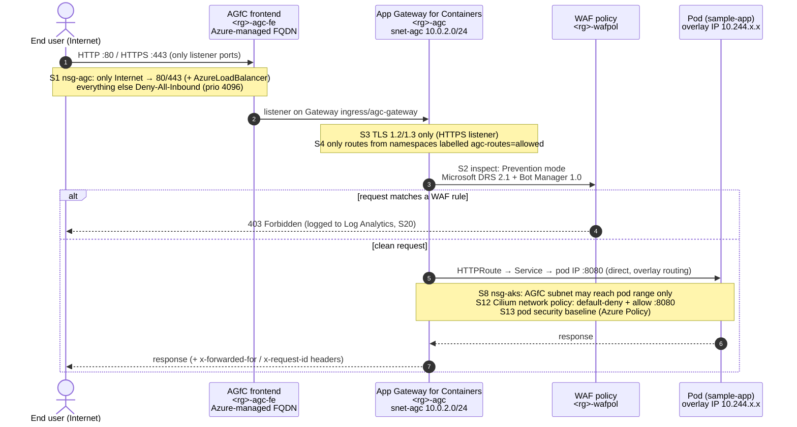
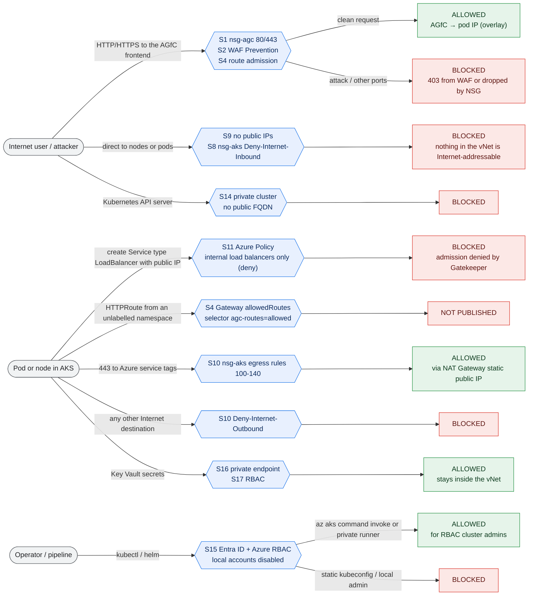
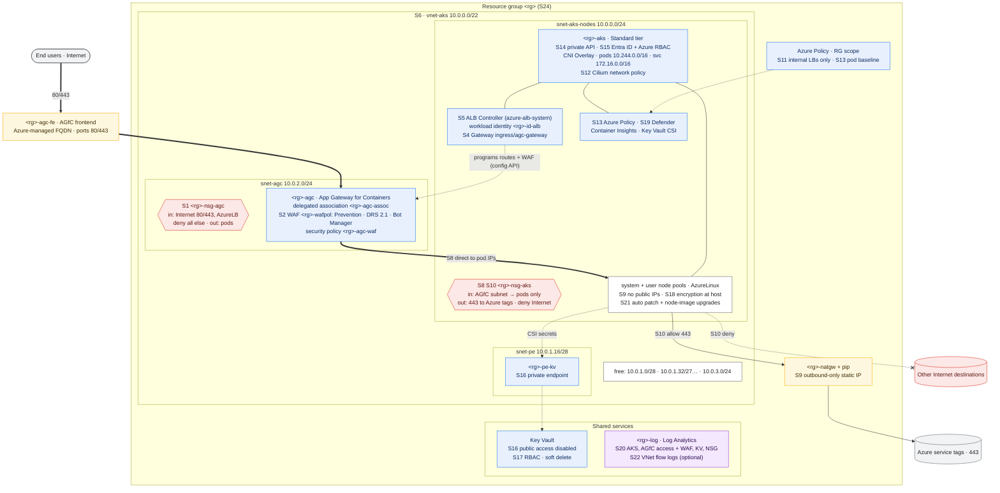
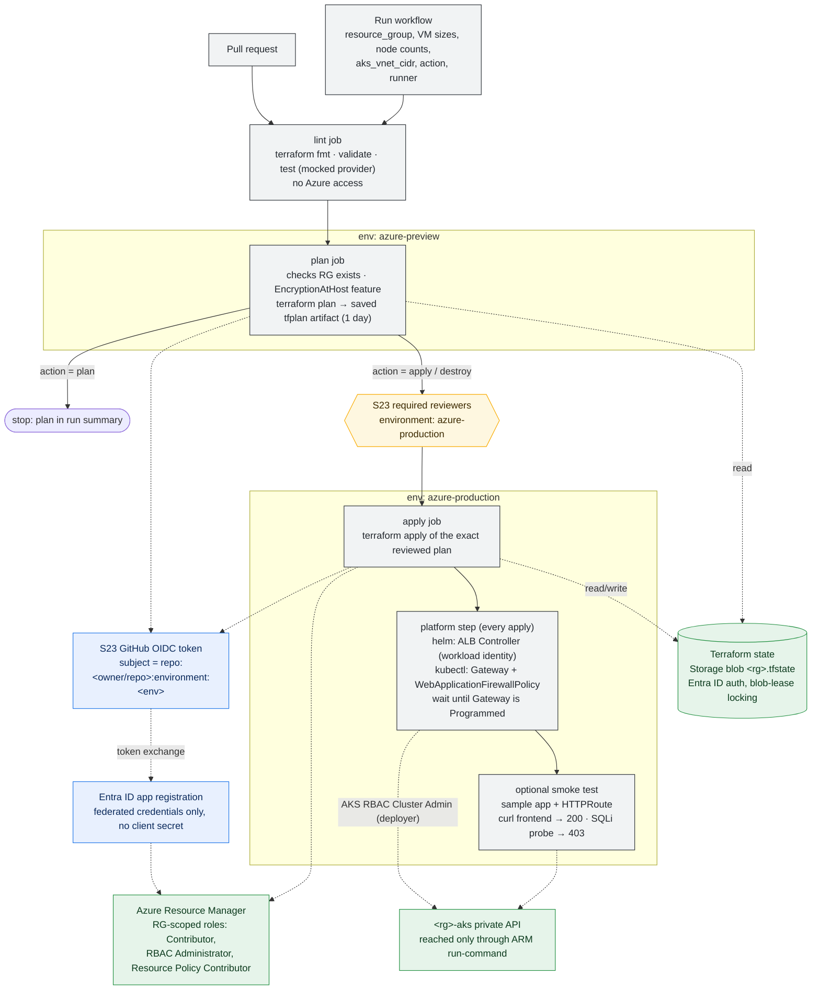
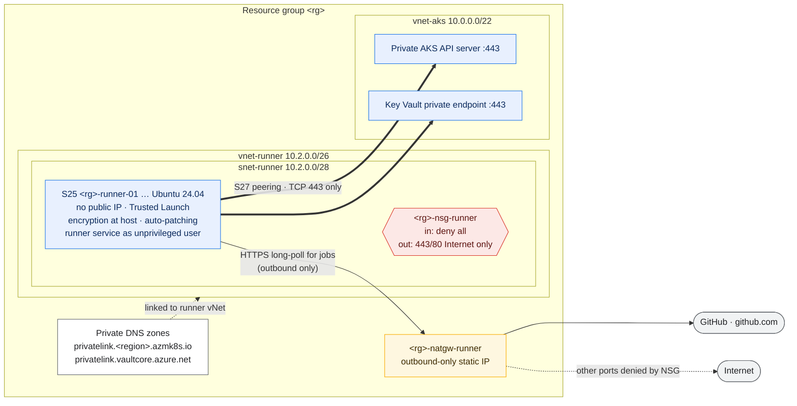

# Architecture & security diagrams

These diagrams describe what [`terraform/`](../terraform) deploys. Addresses shown are the **defaults**; every subnet is derived from the `aks_vnet_cidr` input, so substitute your own ranges (see [README → Network design](../README.md#network-design-and-sizing)). `<rg>` is the resource group name, used as the naming prefix.

PNG exports of every diagram are in [`docs/images/`](images/) for use outside GitHub.

Security controls are tagged **S1–S27** in the diagrams and explained in the [security specification catalogue](#security-specification-catalogue) at the end.

* [1. End-user request flow](#1-end-user-request-flow)
* [2. Allowed vs. blocked traffic paths](#2-allowed-vs-blocked-traffic-paths)
* [3. Detailed network diagram](#3-detailed-network-diagram)
* [4. Deployment & operations flow](#4-deployment--operations-flow)
* [5. Private GitHub runner (optional)](#5-private-github-runner-optional)
* [NSG rule reference](#nsg-rule-reference)
* [Security specification catalogue](#security-specification-catalogue)

---

## 1. End-user request flow

How a single user request reaches a pod. Every hop has at least one control that can reject the request.

> AGfC health-probes the pods directly; a pod only receives traffic once its readiness probe passes. No Kubernetes `Service` is ever exposed on a load balancer.

---

## 2. Allowed vs. blocked traffic paths

Every way traffic could try to enter or leave the environment, and the control that decides it.

---

## 3. Detailed network diagram

### Address plan (defaults)

In the network diagram, subnet and vNet titles omit the `<rg>-` prefix for space; full names are below.

| Network | CIDR | Derived from | Contents | NSG |
|---|---|---|---|---|
| `<rg>-vnet-aks` | `10.0.0.0/22` | `aks_vnet_cidr` | the environment's only vNet | |
| `<rg>-snet-aks-nodes` | `10.0.0.0/24` | 1st `/24` | Node NICs (251 nodes), NAT Gateway attached | `<rg>-nsg-aks` |
| `<rg>-snet-pe` | `10.0.1.16/28` | `/28` in the 2nd `/24` | Key Vault private endpoint | `<rg>-nsg-aks` |
| `<rg>-snet-agc` | `10.0.2.0/24` | 3rd `/24` | App Gateway for Containers association (delegated, exactly `/24`) | `<rg>-nsg-agc` |
| free | `10.0.1.0/28`, `10.0.1.32/27`…, `10.0.3.0/24` | | growth | |
| Pod overlay | `10.244.0.0/16` | `pod_cidr` | Pod IPs; AGfC proxies to these directly | n/a (Cilium policy) |
| Services | `172.16.0.0/16` | `service_cidr` | ClusterIPs; DNS `172.16.0.10` | n/a |

The plan fails if the AKS vNet, pod and service ranges (and the runner vNet, when connected) overlap.

---

## 4. Deployment & operations flow

How changes reach Azure. No long-lived credentials exist anywhere in the pipeline.

---

## 5. Private GitHub runner (optional)

Created by [`runner/`](../runner) and [`deploy-runner.yml`](../.github/workflows/deploy-runner.yml) **before** the AKS workflow. When the AKS workflow runs with `runner = self-hosted`, its Plan/Apply jobs run here, and the AKS deployment adds the peering, NSG rules and DNS links shown in blue.

**Registration flow (S26):** `terraform apply` creates the VMs, and cloud-init installs the Azure CLI and tools and stages the runner. The workflow then requests a 1-hour registration token from the GitHub API with `RUNNER_ADMIN_TOKEN` and runs [`register-runner.sh`](../runner/scripts/register-runner.sh) on each VM through `az vm run-command`. Finally, it waits until GitHub reports every runner **online**. The runner only makes outbound connections to GitHub; nothing connects to it.

---

## NSG rule reference

### `<rg>-nsg-agc` (App Gateway for Containers subnet)

| Prio | Name | Direction | Source | Destination | Ports | Action |
|---|---|---|---|---|---|---|
| 100 | Allow-Internet-HTTP-HTTPS-Inbound | In | Internet | * | TCP 80, 443 | Allow (frontend listeners) |
| 110 | Allow-AzureLoadBalancer-Inbound | In | AzureLoadBalancer | * | * | Allow (required by AGfC) |
| 4096 | Deny-All-Inbound | In | * | * | * | **Deny** |
| 100 | Allow-To-Pods-Outbound | Out | * | Pod range | TCP * | Allow (proxy + health probes) |

NSG rules on the AGfC subnet are fully enforced for associations created after April 23, 2026. Terraform attaches the NSG before it creates the association.

### `<rg>-nsg-aks` (node and private endpoint subnets)

| Prio | Name | Direction | Source | Destination | Ports | Action |
|---|---|---|---|---|---|---|
| 100 | Allow-AGC-To-Pods-Inbound | In | AGfC subnet | Pod range | TCP * | Allow |
| 110 | Deny-AGC-Other-Inbound | In | AGfC subnet | * | * | **Deny** |
| 120 | Allow-Runner-HTTPS-Inbound ¹ | In | Runner vNet | AKS vNet | TCP 443 | Allow |
| 130 | Deny-Runner-Other-Inbound ¹ | In | Runner vNet | * | * | **Deny** |
| 4000 | Deny-Internet-Inbound | In | Internet | * | * | **Deny** |
| 100 | Allow-AzureActiveDirectory-443 | Out | * | AzureActiveDirectory | TCP 443 | Allow |
| 110 | Allow-MicrosoftContainerRegistry-443 | Out | * | MicrosoftContainerRegistry | TCP 443 | Allow |
| 120 | Allow-AzureFrontDoorFirstParty-443 | Out | * | AzureFrontDoor.FirstParty | TCP 443 | Allow |
| 130 | Allow-AzureMonitor-443 | Out | * | AzureMonitor | TCP 443 | Allow |
| 140 | Allow-AzureCloud-443 | Out | * | AzureCloud | TCP 443 | Allow |
| 4000 | Deny-Internet-Outbound | Out | * | Internet | * | **Deny** |

¹ Only present when the AKS deployment is connected to the private runner (`runner_vnet_name` set).

The outbound rules come from [`terraform/config/aks-egress-rules.json`](../terraform/config/aks-egress-rules.json). Azure's built-in rules (AllowVnetInBound/OutBound, AllowAzureLoadBalancerInBound, priority 65000+) still apply. They keep node-to-node, peered and private endpoint traffic working.

### `<rg>-nsg-runner` (private runner subnet)

| Prio | Name | Direction | Source | Destination | Ports | Action |
|---|---|---|---|---|---|---|
| 4096 | Deny-All-Inbound | In | * | * | * | **Deny** |
| 100 | Allow-Internet-HTTPS | Out | * | Internet | TCP 443 | Allow |
| 110 | Allow-Internet-HTTP | Out | * | Internet | TCP 80 | Allow (Ubuntu mirrors) |
| 4000 | Deny-Internet-Outbound | Out | * | Internet | * | **Deny** |

The outbound rules come from [`runner/config/runner-egress-rules.json`](../runner/config/runner-egress-rules.json).

---

## Security specification catalogue

| ID | Control | Where | Configuration | CIS Azure 1.4 section |
|---|---|---|---|---|
| S1 | AGfC subnet NSG | `<rg>-nsg-agc` | Internet → 80/443 and AzureLoadBalancer only; deny-all inbound at 4096; outbound to the pod range | 6 Networking |
| S2 | Web Application Firewall | `<rg>-wafpol` + `<rg>-agc-waf` + `WebApplicationFirewallPolicy` | Prevention mode; Microsoft DRS 2.1 + Bot Manager 1.0; applied to every listener/route of the Gateway. Needs both the Azure security policy and the in-cluster policy; the workflow applies both and verifies a SQL-injection probe gets 403 | Defense in depth |
| S3 | TLS | AGfC listeners | TLS 1.2 and 1.3 only (not configurable lower); HTTPS listener from a Kubernetes TLS Secret, optionally synced from Key Vault | 3 / 9 (TLS ≥ 1.2) |
| S4 | Route admission | Gateway `ingress/agc-gateway` | `allowedRoutes` only from namespaces labelled `agc-routes: allowed`; no `Ingress`/`LoadBalancer` publishing | Defense in depth |
| S5 | ALB Controller identity | `<rg>-id-alb` | Workload identity federated to `azure-alb-system:alb-controller-sa` only; no secrets; *AppGw for Containers Configuration Manager* on the RG + *Network Contributor* on the AGfC subnet only | 1 IAM (least privilege) |
| S6 | Subnet isolation | `<rg>-vnet-aks` | One vNet (required by AGfC with CNI Overlay); AGfC in its own delegated subnet that holds nothing else; every subnet has an NSG | 6 Networking |
| S7 | Direct-to-pod ingress | AGfC + CNI Overlay | AGfC proxies straight to pod IPs; no node ports, no load-balancer Services, no in-cluster ingress proxy to patch | Defense in depth |
| S8 | AKS inbound NSG | `<rg>-nsg-aks` | Only the AGfC subnet → pod range; everything else from the AGfC subnet denied; Internet denied | 6.1 / 6.2 (no RDP/SSH from Internet) |
| S9 | No public IPs on nodes, controlled egress | node subnet | `node_public_ip_enabled = false`; `default_outbound_access_enabled = false`; NAT Gateway (`outboundType userAssignedNATGateway`), so no public LB is created | 6 Networking |
| S10 | Egress allow-list | `<rg>-nsg-aks` + JSON | 443 to five Azure service tags; deny Internet at 4000; editable | 6 Networking |
| S11 | Internal load balancers only | Azure Policy | Built-in `3fc4dc25…` with effect **deny** | Defense in depth |
| S12 | Pod network policy | AKS | Cilium dataplane + network policy; sample app uses namespace default-deny | Defense in depth |
| S13 | Pod security baseline | Azure Policy | Built-in initiative `a8640138…` with effect **deny** (system namespaces excluded) | Defense in depth |
| S14 | Private API server | AKS | `private_cluster_enabled`, no public FQDN; private DNS zone `privatelink.<region>.azmk8s.io` in the resource group, linked to the AKS vNet (and the runner vNet when connected) | 8 (AKS) |
| S15 | Identity & RBAC | AKS | Entra ID integration, Azure RBAC for Kubernetes, local accounts disabled; admins via Entra groups | 8 (RBAC on AKS) |
| S16 | Private Key Vault | Key Vault + `<rg>-pe-kv` | Public network access disabled; private endpoint; private DNS linked to the AKS vNet (and the runner vNet when connected) | 8 (Key Vault private endpoints) |
| S17 | Key Vault hardening | Key Vault | RBAC authorization; soft delete 90 days; purge protection; least-privilege roles | 8 (recoverable, RBAC) |
| S18 | Encryption at host | node pools | Temp disks and caches encrypted; managed disks encrypted at rest by the platform | 7 Virtual Machines |
| S19 | Threat detection | AKS | Defender for Containers sensor; Container Insights via managed identity | 2 Defender for Cloud |
| S20 | Central logging | `<rg>-log` | Diagnostic settings: AKS control plane incl. `kube-audit-admin` and `guard`, AGfC access and WAF logs, Key Vault audit, NSG events, NAT public IP | 5 Logging & Monitoring |
| S21 | Patch management | AKS | `automatic_upgrade_channel = patch`; `node_os_upgrade_channel = NodeImage`; image cleaner every 7 days; AzureLinux OS | 7 Virtual Machines |
| S22 | Network flow logs | Network Watcher | Optional VNet flow logs, 365-day retention, Traffic Analytics; hardened storage account | 6.4 – 6.6 |
| S23 | Secretless, gated pipeline | GitHub Actions | OIDC federation (no client secrets); RG-scoped roles; saved-plan apply behind required reviewers | 1 IAM (least privilege) |
| S24 | Consistent tagging | all taggable resources | Resource group tags copied verbatim; AKS propagates them to its node resource group | Governance |
| S25 | Private self-hosted runner | `runner/` | No public IP, all inbound denied, egress only 443/80 via NAT Gateway; Trusted Launch, encryption at host, platform patching, no password login; no Azure identity on the VM | 6 Networking · 7 Virtual Machines |
| S26 | Secret-free runner registration | `deploy-runner.yml` | 1-hour GitHub registration token requested per run and passed via `az vm run-command`; never in Terraform state, plan artifacts or the VM model | 1 IAM |
| S27 | Least-privilege runner reach | AKS NSG + peering | Runner vNet → AKS vNet on TCP 443 only (API server, Key Vault endpoint); everything else from the runner vNet denied; private DNS zones linked so names resolve privately | 6 Networking |
